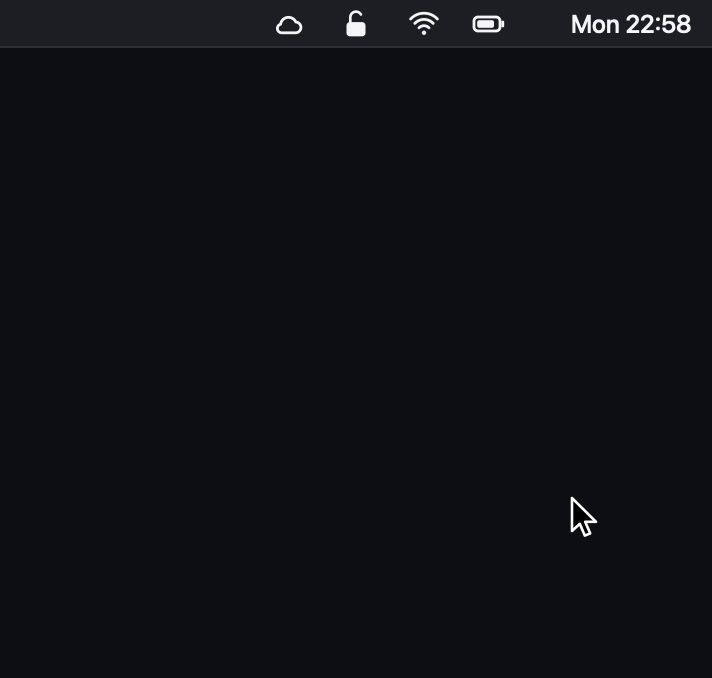

# OpenFortiMac


A native macOS menu bar app for managing [OpenFortiVPN](https://github.com/adrienverge/openfortivpn) connections. Built with Swift and SwiftUI, it sits in your menu bar and lets you connect/disconnect with a single click.

Passwords are stored in the macOS Keychain.




## Installation

### Homebrew (recommended)

```bash
brew install --cask rempairamore/tap/openfortimac
```

This installs the app and [openfortivpn](https://formulae.brew.sh/formula/openfortivpn) from the [rempairamore/homebrew-tap](https://github.com/rempairamore/homebrew-tap) tap. Update with `brew upgrade --cask openfortimac`.

### DMG

1. Install openfortivpn: `brew install openfortivpn`
2. Download the latest `.dmg` from [Releases](../../releases), open it, and drag **OpenFortiMac** to your Applications folder.

### Build yourself

To build from source instead (Xcode 26 or later required):

```bash
git clone https://github.com/rempairamore/OpenFortiMac.git
cd OpenFortiMac
chmod +x build_dmg.sh
./build_dmg.sh
```

### Verify your download

Releases are built by [GitHub Actions](.github/workflows/release.yml) from the tagged commit, not on a developer machine. Each release lists the DMG's SHA-256 and a VirusTotal report. To check that the DMG you downloaded is exactly the one built from this repository (needs the [GitHub CLI](https://cli.github.com)):

```bash
gh attestation verify OpenFortiMac_v1.3.1.dmg -R rempairamore/OpenFortiMac
```

Homebrew checks the same SHA-256 before installing.

Releases are signed with the self-signed certificate "OpenFortiMac Self-Signed" (SHA-1 `7F:43:4F:39:7A:3D:70:CD:9A:0E:9F:74:C0:5D:30:E8:08:04:F1:AA`). It is not an Apple certificate, so Gatekeeper still asks you to confirm the first launch, but it keeps the app's identity stable: macOS does not ask for Keychain access again after updates. Check it with `codesign -dvv /Applications/OpenFortiMac.app`.

### First launch

OpenFortiMac is not notarized by Apple, so macOS blocks it the first time. Open **System Settings → Privacy & Security**, scroll down and click **Open Anyway** next to the OpenFortiMac message. This is needed only once.

### Allow openfortivpn to run as root

openfortivpn needs root privileges to create the VPN tunnel. On first launch OpenFortiMac opens **Settings → Permission**: click **Set Up…** and enter your administrator password once.

The app installs this rule in `/etc/sudoers.d/openfortimac` (validated with `visudo`, owned by root, read-only):

```
YOUR_USERNAME ALL = (root) NOPASSWD: /opt/homebrew/bin/openfortivpn
```

Click **Remove** in the same place to delete it.

> **Security note:** with this rule any process running as your user can start openfortivpn as root without a password, and `/opt/homebrew` is writable by your user. This is the usual trade-off for openfortivpn GUIs; remove the rule if you stop using the app.

<details>
<summary>Manual setup</summary>

```bash
sudo visudo -f /etc/sudoers.d/openfortimac
```

Add this line (replace `YOUR_USERNAME` with your macOS username):

```
YOUR_USERNAME ALL = (root) NOPASSWD: /opt/homebrew/bin/openfortivpn
```

The path is `/opt/homebrew/bin/openfortivpn` on Apple Silicon and `/usr/local/bin/openfortivpn` on Intel Macs. Run `which openfortivpn` to check.
</details>

### Configure

A lock icon appears in the menu bar. Click it → **Settings** → **Servers** tab → add your VPN servers.

## Usage

Click the menu bar icon to open the panel:

- **Status card** — the current server, connection time and tunnel IP, with **Disconnect** (⌘D)
- **Servers** — hover a server and click **Connect**; a server without a saved password opens its editor
- **Footer** — add a server, Settings (⌘,), Log, Quit (⌘Q)

If the administrator permission is missing, a banner in the panel links to **Settings → Permission**. Right-click the menu bar icon for a quick menu with Disconnect, Settings and Quit.

Each server can have its own icon, chosen in the server editor.

| Icon | Status |
|------|--------|
| 🔓 | Disconnected |
| 🔄 | Connecting / Disconnecting |
| 🔒 (green) | Connected |

**Settings → General → Menu bar icon → Monochrome** switches to a template shield that follows the menu bar appearance and shows how many tunnels are up:

| Icon | Status |
|------|--------|
| Outlined shield | Disconnected |
| Half-filled shield | Connecting |
| Shield with checkmark | One tunnel connected |
| Filled shield with a number | That many tunnels connected |
| Small dot next to it | Another tunnel is connecting |

### Multiple connections

Turn on **Settings → General → Allow multiple connections at once** to run several tunnels side by side, each with its own status card, log lines and Disconnect button. When it is off (the default), connecting to a server drops the current one.

Only one tunnel should own the default routes and DNS. For the others, open the server editor → **Advanced**:

- **Don't change routes or DNS** — runs openfortivpn with `--no-routes --no-dns`
- **Static routes** — CIDRs (one per line) routed through this tunnel's own ppp interface while it is up; the interface is detected after connecting, since ppp numbering is dynamic. Needs the sudo rule to allow `/sbin/route` for ppp interfaces: the panel shows an **Update** banner when it is missing.
- **Connect at launch** — connect automatically when OpenFortiMac starts
- **Reconnect automatically** — when the tunnel drops (network change, sleep, gateway timeout), reconnect after 2, 5, 10, 20, 30, then every 60 seconds until you disconnect. While offline it waits for the network and retries as soon as it is back. Wrong credentials or certificate stop the retries.

Quitting OpenFortiMac (menu, ⌘Q, `brew uninstall`, logout or `SIGTERM`) disconnects every tunnel first, so openfortivpn restores routes and DNS.

### Command line

The app executable doubles as a command line tool. Link it into your `PATH`:

```bash
ln -s /Applications/OpenFortiMac.app/Contents/MacOS/OpenFortiMac /opt/homebrew/bin/openfortimac
```

```bash
openfortimac list                     # servers and their state
openfortimac status [--json]          # active tunnels: time, IP, ppp interface, routes
openfortimac connect office           # name, unique prefix or id; waits until up
openfortimac disconnect office        # or: disconnect --all
openfortimac logs -f                  # openfortivpn output (~/Library/Logs/OpenFortiMac)

openfortimac add "Branch" --host vpn.example.com --port 10443 --user me --password \
    --no-routes-dns --route 10.20.30.0/24
openfortimac edit branch --add-route 10.40.0.0/16 --auto-connect --auto-reconnect
openfortimac show branch
openfortimac remove branch --yes      # also deletes the saved password
openfortimac settings --allow-multiple on --menu-bar-icon monochrome
openfortimac permission update        # sudo rule incl. static routes (admin dialog)
```

Connect and disconnect run through the app (started in the background if needed), which owns the tunnels, the Keychain and the sudo rule. Passwords are read with `--password` (prompt) or `--password-stdin`, never from arguments.

The app sends native macOS notifications on connect, disconnect, and errors.

## Configuration

Server profiles are stored at `~/Library/Application Support/OpenFortiMac/config.json`. You can edit them through the Settings GUI or manually:

```json
{
    "servers": [
        {
            "id": "office-1",
            "name": "Office VPN",
            "host": "vpn.company.com",
            "port": 443,
            "username": "john.doe"
        }
    ],
    "openfortivpn_path": "/opt/homebrew/bin/openfortivpn"
}
```

Optional fields, written only when used:

| Field | Where | Meaning |
|-------|-------|---------|
| `allow_multiple_connections` | top level | Run several tunnels at once (default `false`) |
| `menu_bar_icon` | top level | `classic` (default) or `monochrome` |
| `no_routes_dns` | server | Pass `--no-routes --no-dns` (default `false`) |
| `static_routes` | server | CIDRs routed through the tunnel's ppp interface, e.g. `["10.20.30.0/24"]` |
| `auto_connect` | server | Connect when OpenFortiMac starts (default `false`) |
| `auto_reconnect` | server | Reconnect when the tunnel drops (default `false`) |

Passwords are **not** stored in this file — they live in the macOS Keychain.

The `trusted_cert` field is optional. If omitted, the app uses `--trusted-cert=any`.

## Troubleshooting

**"openfortivpn not found"** — Check the binary path in Settings → General. Run `which openfortivpn` to find yours.

**"Administrator permission not set up"** — The sudo rule is missing or points to another openfortivpn path. Open Settings → Permission and click **Set Up…** (or **Update…**).

**"OpenFortiMac is damaged" / "cannot be opened"** — See [First launch](#first-launch).

**Connection fails** — Open Settings → Log tab for details. 

## Uninstall

### Homebrew

```bash
brew uninstall --cask openfortimac
```

This also removes `/etc/sudoers.d/openfortimac` (brew asks for your password). Add `--zap` to delete the configuration too.

### Manual

1. Settings → Permission → **Remove**
2. Quit OpenFortiMac
3. Delete from Applications: `rm -rf /Applications/OpenFortiMac.app`
4. Remove config: `rm -rf ~/Library/Application\ Support/OpenFortiMac`

If you followed the manual setup of older versions, also run `sudo rm /etc/sudoers.d/openfortivpn`.

## Releasing

1. Bump `MARKETING_VERSION` in Xcode and add a `## vX.Y.Z` section to `CHANGELOG.md`.
2. Merge to `main`. That's it.

When `main` gets a version that has no tag yet, the [Release workflow](.github/workflows/release.yml) builds a universal DMG, attests its provenance, scans it on VirusTotal, publishes the GitHub release (creating the `vX.Y.Z` tag) and updates [homebrew-tap](https://github.com/rempairamore/homebrew-tap) through a pull request that it merges itself once `brew style` and `brew audit` pass. `brew upgrade` users get the new version right away.

To try a build without shipping it, push a tag with a suffix (for example `v1.3.2-rc.1`): it creates a pre-release and skips Homebrew. The workflow needs these repository secrets:

- `SIGNING_CERT_P12` (base64 of the certificate's `.p12`) and `SIGNING_CERT_PASSWORD`: releases fail without them, and the workflow checks the app is signed with the certificate whose SHA-1 is in `EXPECTED_CERT_SHA1`
- `VIRUSTOTAL_API_KEY`
- `HOMEBREW_TAP_TOKEN`: fine-grained token with *Contents* and *Pull requests* write access to `homebrew-tap` only

Local builds use the certificate when it is in your keychain and fall back to an ad-hoc signature otherwise.

The demo GIF at the top of this README is generated with `python3 scripts/make_panel_demo.py` (macOS and ffmpeg required) from example data.
